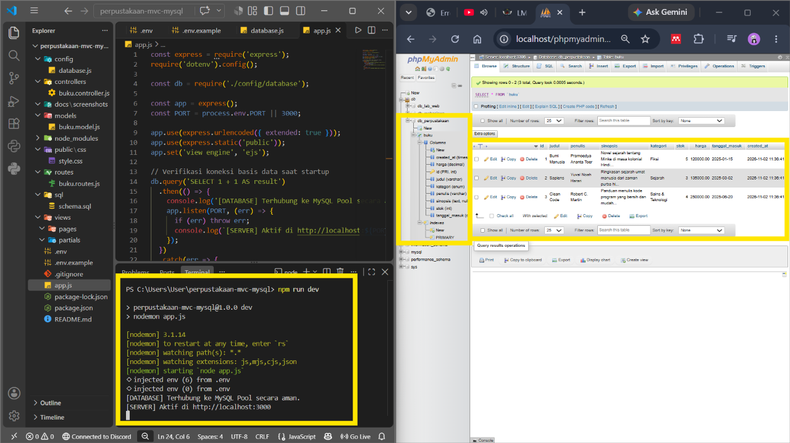
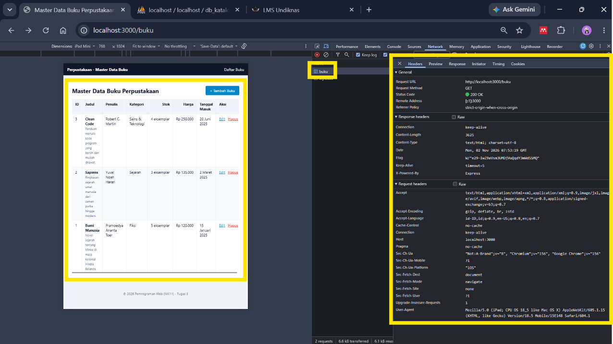
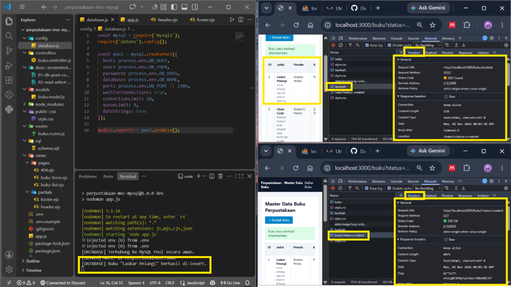
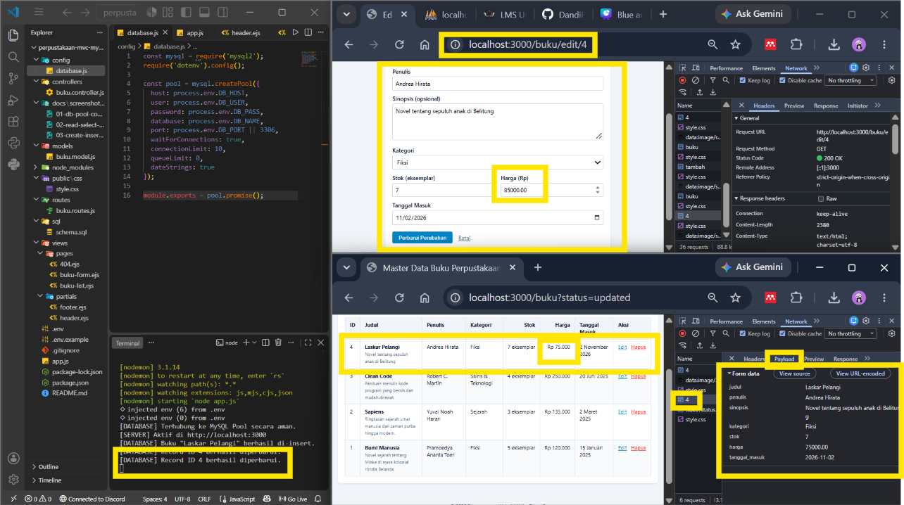
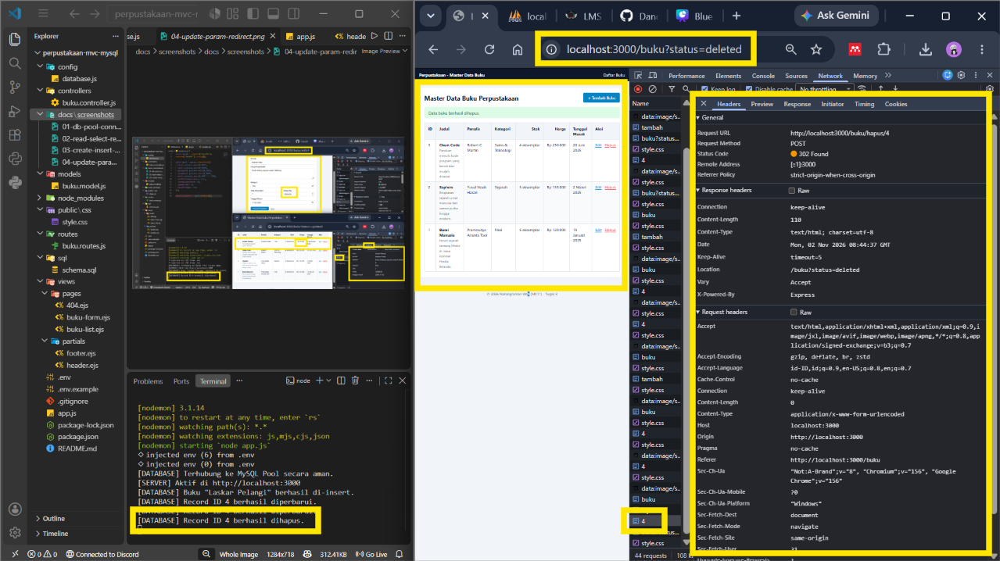
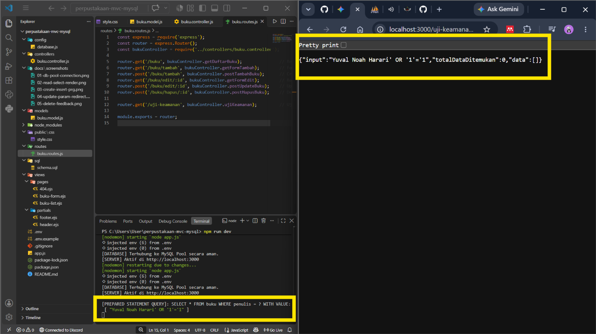

# Sistem Manajemen Master Data Buku Perpustakaan

Tugas 3 Terstruktur (Kasus Mandiri Non-Cookbook) — Pemrograman Web (MK11), Pertemuan 6/7.
Aplikasi CRUD berbasis **Node.js + Express + EJS + MySQL** dengan *connection pool*, *prepared statements* pada seluruh query, dan arsitektur MVC yang ketat.

- **Nama:** `I Wayan Yoga Karang Saputra`
- **NIM:** `42530013`
- **Kelas:** `Pagi / Teknologi Informasi`

---

## 1. Fitur Utama

- Daftar buku dalam tabel dengan format harga (`Rp 250.000`) dan tanggal (`20 Juni 2025`) yang rapi.
- Tambah buku lewat formulir (POST) dengan pola **Post-Redirect-Get (PRG)**.
- Edit buku lewat rute dinamis `/buku/edit/:id` dengan formulir **pre-filled**.
- Hapus buku dengan dialog konfirmasi di sisi klien.
- Validasi dan sanitasi input di server (judul, penulis, kategori, stok, harga, tanggal).
- Penanganan data tidak ditemukan dan `:id` tidak valid dengan halaman **404**.
- Pesan status (created / updated / deleted) setelah redirect.
- Endpoint uji keamanan SQL Injection (`/uji-keamanan`).

## 2. Teknologi

| Komponen | Keterangan |
|---|---|
| Runtime | Node.js |
| Framework | Express |
| View Engine | EJS |
| Database | MySQL (`mysql2/promise`, `createPool`) |
| Konfigurasi | `dotenv` |
| Dev tool | `nodemon` |

## 3. Arsitektur Proyek (MVC)

```
perpustakaan-mvc-mysql/
├── config/
│   └── database.js              # Connection pool (mysql2/promise)
├── controllers/
│   └── buku.controller.js       # Alur data + validasi, tanpa SQL
├── models/
│   └── buku.model.js            # SELURUH query SQL (prepared statements)
├── routes/
│   └── buku.routes.js
├── views/
│   ├── pages/                   # buku-list.ejs, buku-form.ejs, 404.ejs
│   └── partials/                # header.ejs, footer.ejs
├── public/css/style.css
├── sql/schema.sql               # DDL + data awal
├── docs/screenshots/            # bukti pengujian
├── app.js
├── .env                         # TIDAK diunggah ke GitHub
├── .env.example                 # template konfigurasi
└── package.json
```

Pemisahan layer:

- **Model**: satu-satunya tempat query SQL.
- **Controller**: menerima request, memvalidasi input, memanggil Model, lalu memilih view atau redirect.
- **View (EJS)**: hanya menampilkan UI.

## 4. Skema Database

Database: `db_perpustakaan`, tabel: `buku`.

| Kolom | Tipe | Keterangan |
|---|---|---|
| `id` | INT AUTO_INCREMENT PRIMARY KEY | Primary key |
| `judul` | VARCHAR | Wajib, maks. 150 karakter |
| `penulis` | VARCHAR | Wajib, maks. 100 karakter |
| `sinopsis` | TEXT | Opsional (boleh NULL) |
| `kategori` | ENUM | `Fiksi`, `Non-Fiksi`, `Sains & Teknologi`, `Sejarah`, `Referensi` |
| `stok` | INT | Bilangan bulat >= 0 |
| `harga` | DECIMAL | Angka >= 0 |
| `tanggal_masuk` | DATE | Format `YYYY-MM-DD` |
| `created_at` | TIMESTAMP | Default `CURRENT_TIMESTAMP` |

Skrip lengkap (DDL dan data awal) ada di [`sql/schema.sql`](sql/schema.sql).

## 5. Instalasi & Menjalankan

```bash
# 1. Clone repositori
git clone <url-repo-anda>
cd perpustakaan-mvc-mysql

# 2. Pasang dependensi
npm install

# 3. Salin template environment lalu isi sesuai MySQL lokal
cp .env.example .env

# 4. Import skema database
#    jalankan isi sql/schema.sql melalui phpMyAdmin / MySQL Workbench / CLI

# 5. Jalankan aplikasi
npm run dev     # mode pengembangan (nodemon)
npm start       # mode biasa
```

Aplikasi berjalan di `http://localhost:3000/buku`.

### Konfigurasi `.env`

Seluruh kredensial database disimpan di `.env` (tidak ikut ter-commit). Template ada di `.env.example`:

```env
PORT=3000
DB_HOST=localhost
DB_USER=root
DB_PASS=
DB_NAME=db_perpustakaan
DB_PORT=3306
```

## 6. Daftar Endpoint

| Operasi | Endpoint | Method | Parameter / Payload | Respon |
|---|---|---|---|---|
| Read (All) | `/buku` | GET | - | 200 OK (render tabel) |
| Form Create | `/buku/tambah` | GET | - | 200 OK (render form) |
| Create | `/buku/tambah` | POST | `req.body` | 302 → `/buku?status=created` |
| Read (One) | `/buku/edit/:id` | GET | `req.params.id` | 200 OK (form terisi) / 404 |
| Update | `/buku/edit/:id` | POST | `req.params.id` & `req.body` | 302 → `/buku?status=updated` |
| Delete | `/buku/hapus/:id` | POST | `req.params.id` | 302 → `/buku?status=deleted` |
| Uji Keamanan | `/uji-keamanan` | GET | query string | 200 OK (JSON) |

## 7. Standar Keamanan Query

Seluruh query (`SELECT ... WHERE`, `INSERT`, `UPDATE`, `DELETE`) memakai **prepared statements** melalui `db.execute()` dengan placeholder `?`. Tidak ada konkatenasi string maupun template literal untuk nilai input.

```js
// models/buku.model.js
const [rows] = await db.execute('SELECT * FROM buku WHERE id = ?', [id]);
```

Lapisan pengamanan lain:

- Kredensial database dibaca dari `process.env`, tidak ditulis di kode.
- Parameter `:id` divalidasi hanya berisi angka sebelum menyentuh database.
- Input formulir divalidasi dan dibersihkan (`trim`, whitelist kategori, cek tipe angka dan tanggal).
- Sinopsis kosong dikirim sebagai `NULL` (bukan `undefined`) agar aman bagi prepared statement.

## 8. Logbook Pengujian & Integritas Kode (Traceability Matrix)

| ID Uji | Fitur / Operasi | Target Endpoint URL | HTTP Method | Skenario Pengujian | Hasil yang Diharapkan | Status | Bukti Tangkapan Layar |
|---|---|---|---|---|---|---|---|
| TC-01 | Koneksi Pool | App Startup | - | Server dijalankan pertama kali (`npm run dev`) | Terminal mencetak `[DATABASE] Terhubung ke MySQL Pool secara aman.` tanpa error | Pass | `docs/screenshots/01-db-pool-connection.png` |
| TC-02 | Read (All) | `/buku` | GET | Akses halaman daftar buku | Seluruh record tabel `buku` tampil di antarmuka EJS, DevTools mencatat 200 OK | Pass | `docs/screenshots/02-read-select-render.png` |
| TC-03 | Create | `/buku/tambah` | POST | Submit formulir buku baru | Data tersimpan di DB, DevTools mencatat 302 Found lalu 200 OK pada `/buku?status=created` | Pass | `docs/screenshots/03-create-insert-prg.png` |
| TC-04 | Update | `/buku/edit/:id` | POST | Mengubah harga buku (form pre-filled) | Nilai kolom `harga` pada baris MySQL berubah sesuai input baru | Pass | `docs/screenshots/04-update-param-redirect.png` |
| TC-05 | Delete | `/buku/hapus/:id` | POST | Eksekusi tombol hapus buku | Baris terhapus dari MySQL, UI ter-refresh (302 → `/buku?status=deleted`) | Pass | `docs/screenshots/05-delete-feedback.png` |
| TC-06 | Keamanan | `/uji-keamanan` | GET | Input `Yuval Noah Harari' OR '1'='1` via URL | Prepared Statement memperlakukan input sebagai literal string (No Injection), `totalDataDitemukan: 0` | Pass | `docs/screenshots/06-sql-injection-mitigation.png` |

### Pratinjau Bukti

**TC-01 — Koneksi Pool**


**TC-02 — Read (All)**


**TC-03 — Create + PRG**


**TC-04 — Update**


**TC-05 — Delete**


**TC-06 — Mitigasi SQL Injection**


## 9. Pemetaan terhadap Rubrik Penilaian

| Kriteria | Implementasi |
|---|---|
| Kepatuhan Prepared Statements & Keamanan | Semua query CRUD memakai `db.execute()` dengan `?`; kredensial di `.env` dan `.env.example` tersedia; validasi input ketat; uji SQL Injection terdokumentasi (TC-06) |
| Fungsionalitas CRUD & Rute Dinamis | CRUD penuh; `req.params.id` dipakai untuk edit dan hapus; form edit pre-filled; pola PRG konsisten; 404 untuk data tidak ditemukan |
| Arsitektur Model Layer & Connection Pooling | Query terisolasi di `models/`; `createPool` dengan interface Promise; `async/await` dengan `try-catch` |


